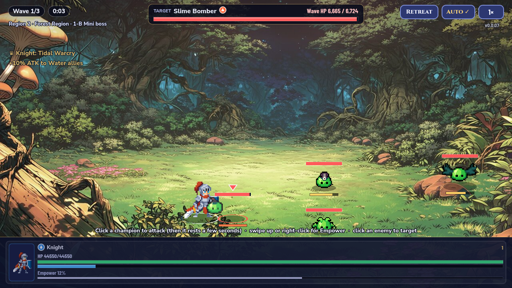
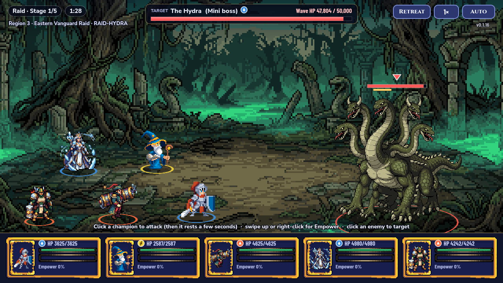

# Dev log: Eastern Front Saga

Eastern Front Saga is a squad battle RPG for PC, built in Godot 4.7 with C#. This log covers the
main game, which lives in a private repository; this repo holds the battle model pulled out of it.
Every version was played and reviewed before the next one started, and the feedback from each
playtest decided what came next.

## Week 1: from one battle to a game (Nov 10 to Nov 13)

**v0.0.01: one battle.** I set the scope small on purpose: five champions against two waves and a
mini boss, tap to attack, Sparks, Empower, elements, and a win or lose screen. The rules went into
a plain C# engine with no Godot code in it, so they could be tested without opening the game.
That split is the reason this repository could exist at all.

**v0.0.02 to v0.0.04: a game around the battle.** Save files, levels and XP, a home screen,
quests, and a first summon pool. Playtesting changed the battle from turn-based to real time:
champions rest for a few seconds after attacking and enemies attack on their own timers. That
is the model in `Battle.cs` and `Battle.Enemies.cs`.

**v0.0.05 to v0.0.12: depth.** Leader skills, more regions and bosses, healers, daily rewards and
challenges. v0.0.12 was one big update that pulled the attack effects and challenge rules into
specs before coding, which became the habit: write a plan first, build after.

## Week 2: systems (Nov 13 to Nov 17)

**v0.1.01 to v0.1.05: the battle grows up.** An attack animation overhaul for the rarest
champions, freeze (it stops Empowers, and the next hit shatters the ice), healing-only Empowers,
and selling and locking champions.

**v0.1.06 to v0.1.12: progression.** Items, Evolution, Infusion, and two more regions. Freeze and
healing are both in this model (`Battle.Empower.cs`).

**v0.1.13 to v0.1.17: world and raids.** A story map, a ground and scene audit, and Raids: one
giant boss that a clan wears down over many attempts, with damage carrying over. The raid boss
pool was sized with a headless Auto simulation, the same idea as `BattleSimulator` here.

## Week 3: replayability (Nov 18 to Nov 22)

**v0.1.18 to v0.1.21: story and polish.** Story scenes and a tutorial, ten remade Godly Empowers,
faster raids, and a home base rework.

**v0.1.22 to v0.1.27: Boss Rush Tower.** An 18-room random node map with blessings, a Front Line
that threatens your settlements, skill trees for top-rarity champions, missions and walkthroughs.

**v0.1.28 to v0.1.33: endgame.** Summon tokens, a Codex, Elemental Rifts, Bulletin Board jobs,
Hard mode, and Clans with roles and a weekly league. By v0.1.33 the engine had 848 automated
checks.

## What I learned

- **Keep the rules away from the screen.** Because the battle engine never touched Godot, I could
  test it, run thousands of simulated battles for balance, and pull it out into this repo.
- **Seeded randomness makes bugs reproducible.** A bug report with a seed is a bug I can replay.
- **Balance is data.** Most tuning was a JSON change backed by a simulator run, not a code change.
- **Small versions, fast feedback.** Over 50 versions in two weeks, each with a short list of
  questions answered before the next one started.

## This repository (Nov 24)

Pulled the battle model out of the game into a standalone .NET 8 library with 64 tests, a console
demo and a balance report. The commit history shows each step in order.
