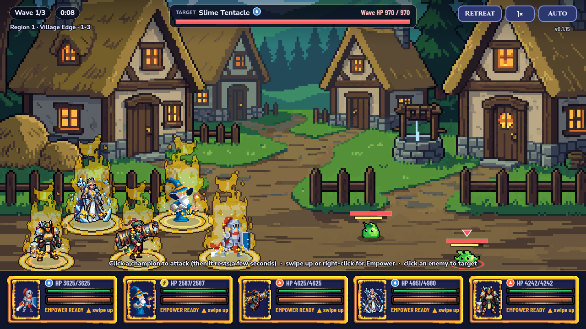
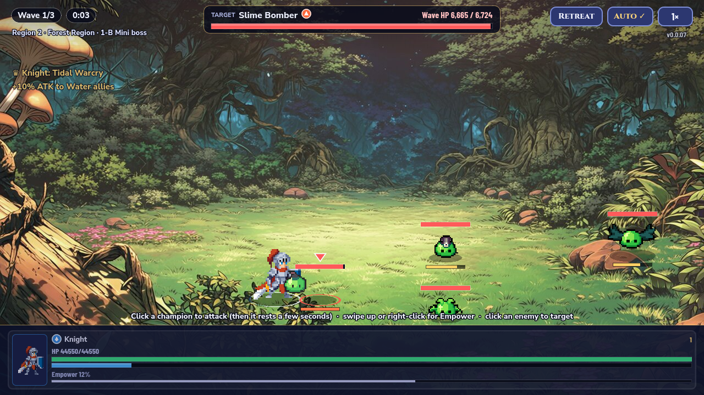
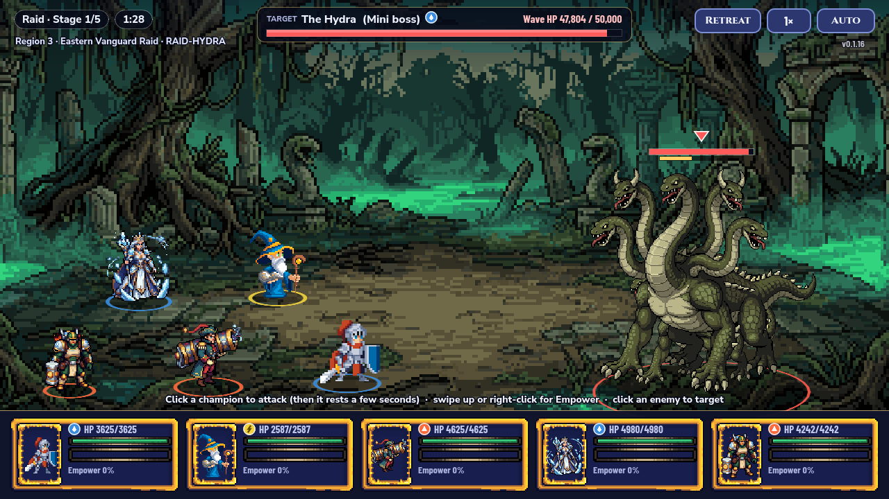

# OpenSource-GameModel1


The battle rules from **Eastern Front Saga**, my squad RPG made in Godot 4 with C#, pulled out
into a small standalone C# library you can build, test and run with nothing but the .NET SDK.

In the game, five champions fight waves of enemies in real time. You tap a champion to attack,
time attacks together to set off **Sparks**, fill each champion's gauge, and use their
**Empower** special moves. This repository is that rule set with no graphics, sound or input,
so you can read it and test it on its own.



## What's in the model

| System | Where | What it does |
|---|---|---|
| Elements | `src/GameModel/Elements` | 7 elements; a 5-element cycle plus Light and Dark. Strong hits deal 1.5x, weak hits 0.75x |
| Units | `src/GameModel/Units` | Immutable `UnitDef` data and a live `Unit` with HP, gauge and timers |
| Damage | `Battle/DamageCalculator.cs` | Pure formula: ATK, DEF, a 15% damage floor, element, variance, Spark |
| Battle | `Battle/Battle*.cs` | Waves, attacks, cooldowns, targeting, Sparks, gauge, win and loss |
| Empower | `Battle/Battle.Empower.cs` | Single-target, area and healing special moves |
| Enemies | `Battle/Battle.Enemies.cs` | Enemy timers, boss timers, random targets |
| Status | `Battle/Battle.cs` | Freeze and shatter, boss enrage under half HP |
| Data | `Data/DataLoader.cs`, `data/*.json` | Champions and stages loaded from JSON and checked when they load |
| Auto play | `Simulation/` | The game's Auto button, plus a simulator for checking balance |

### Design choices

- **Time is passed in, not read from a clock.** Every battle call takes the current battle time,
  so the same code runs a 60 fps game, a unit test and a 500-battle balance run.
- **All randomness goes through `IRandom`.** With a seed, a battle replays exactly the same way,
  and tests use `FixedRandom` so every damage number can be checked by hand.
- **Balance numbers are data.** `BattleTuning` and the JSON files hold every number, so tuning
  needs no code change. The boss in the sample stage was retuned using the simulator's report
  (see the commit history).
- **Errors show up when data loads.** Bad JSON (an Empower with no gauge, an unknown squad
  member) throws an error when the file loads, not halfway through a fight.

## Run it

Requires the [.NET 8 SDK](https://dotnet.microsoft.com/download).

```bash
dotnet test                                              # 64 unit tests
dotnet run --project demo/GameModel.Demo                 # watch one Auto battle
dotnet run --project demo/GameModel.Demo -- --seed 7     # a different battle
dotnet run --project demo/GameModel.Demo -- --runs 500   # balance report
```

Sample output:

```
=== Forest Road (seed 1) ===
Squad: Knight [Water], Wizard [Lightning], Dwarf [Earth], Pyromancer [Fire], Satyr [Light]

[  0.00s] Wave 1/3: Goblin, Goblin Archer, Slime
[  7.15s] Wizard uses Chain Storm!
[  7.21s] Goblin falls to Wizard.
...
[ 88.45s] Cyclops falls to Pyromancer.
[ 88.45s] Stage cleared. Victory!

Result    : Won in 88.5 s
Survivors : 4/5
Sparks    : 103
Empowers  : 19
```

## Screenshots from the full game

| Early build (v0.0.07) | Raid boss (v0.1.16) |
|---|---|
|  |  |

The full game's art comes from licensed asset packs and is not included or licensed here; the
screenshots are only to show what the model drives.

## Dev log

See [DEVLOG.md](DEVLOG.md) for how the game grew from a one-battle prototype to v0.1.33.

## How this was built

I designed the game and its systems, and I wrote the code with help from an AI coding assistant
(Claude). I decided what to build, tested each build myself, and sent back feedback that shaped
the next one. The commit history in this repository is real and in order: each commit is one step
of pulling the battle model out of the game, with its tests.
